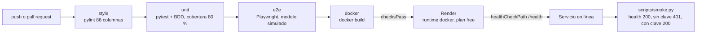

# Arquitectura del HR Assistant

## Visión general

HR Assistant es una API web sin estado que permite al personal de Recursos Humanos
consultar información de empleados en lenguaje natural. Un único agente con bucle
acotado orquesta un modelo de lenguaje y dos herramientas de solo lectura sobre un
archivo JSON de empleados.

Desde la sesión 2, cada petición se puede rastrear: lleva un `request_id`, deja
eventos en un log JSON, alimenta las métricas del proceso y, si se enciende,
genera trazas en LangSmith.

Desde la sesión 3 existe un modelo real (Cloudflare Workers AI a través de AI
Gateway) y cuatro palancas de costo: enrutamiento por regla, ventana de historial,
tope de tokens de salida y caché del gateway. Cada respuesta dice qué modelo usó,
por qué y cuánto costó.

Desde la sesión 4 el producto está listo para Internet:

- `POST /ask` y `GET /metrics` piden una clave por cliente (ADR 0010).
- Cada cliente tiene un límite de peticiones por minuto (ADR 0011).
- Con `ENVIRONMENT=production`, el producto se niega a arrancar si la configuración es insegura (ADR 0012).
- Se empaqueta en Docker, pasa un pipeline de CI y Render lo publica solo si el pipeline pasa.

Desde el reto de seguridad reforzada (ADR 0013, `doc/security.md`):

- La PII (correo, teléfono, tarjeta, CURP, RFC) se oculta en la pregunta, en el historial y en la respuesta.
- La respuesta se valida: sin secretos, no vacía y con largo máximo.
- Los argumentos de las herramientas se validan antes de tocar el directorio.
- Los intentos de inyección se detectan y se auditan; cada detección deja un evento `security`.

## Diagrama de componentes

```mermaid
graph TD
    subgraph Navegador
        UI[index.html<br>clave en sessionStorage<br>pregunta, historial,<br>request_id, modelo y costo]
    end

    subgraph FastAPI - main.py
        MW[middleware.py<br>request_id, latencia,<br>client en el log, errores 500]
        STATIC[GET /]
        HEALTH[GET /health]
        DOCS[/docs/]
        DEP[ClientGuard<br>401 y 429]
        ASK[POST /ask<br>_screen_input, redactions<br>502 si el modelo falla]
        MET[GET /metrics]
    end

    subgraph Seguridad
        AUTH[auth.py<br>API_KEYS, compare_digest]
        RL[ratelimit.py<br>ventana de 60 s por cliente]
        COMP[compliance.py<br>reglas de producción]
        PII[pii.py<br>redact_pii, regex y Luhn]
        GUARD[guardrails.py<br>inyección, secretos,<br>salida, argumentos]
        SEC[security.py<br>SecurityAudit, sin valores]
    end

    subgraph Nucleo
        ROUTE[routing.py<br>regla de modelo<br>ventana de historial]
        AGENT[agent.py<br>Bucle con tope<br>tokens, costo, client]
        LLM[llm.py<br>Model.complete -> Completion]
        FAKE[FakeModel<br>MODEL_SMALL y MODEL_LARGE]
        GW[gateway.py<br>GatewayModel]
        PRICE[pricing.py<br>costo por llamada]
        DIR[directory.py<br>get_employee<br>search_by_department]
    end

    subgraph Observabilidad
        LOG[logs.py<br>JSON a stdout]
        METRICS[metrics.py<br>en memoria por proceso<br>incluye security]
        TRACE[tracing.py<br>traceable opcional]
        CLOCK[clock.py<br>reloj inyectado]
    end

    JSON[(employees.json)]
    PRICES[(model_prices.json)]
    CF[(Cloudflare AI Gateway<br>Workers AI)]
    LS[(LangSmith)]
    CONFIG[config.py<br>Variables de entorno]

    UI -- X-API-Key, X-Request-ID --> MW
    MW --> STATIC
    MW --> HEALTH
    MW --> DOCS
    MW --> DEP
    DEP -- clave --> AUTH
    DEP -- cliente, hora de llegada --> RL
    DEP --> ASK
    DEP --> MET
    ASK -- pregunta e historial --> GUARD
    ASK -- pregunta e historial --> PII
    ASK -- texto limpio --> ROUTE
    ROUTE -- modelo, motivo, historial recortado --> ASK
    ASK -- question, history, model, request_id, client --> AGENT
    AGENT -- complete --> LLM
    LLM --> FAKE
    LLM --> GW
    GW -- HTTPS, cf-aig-cache-ttl --> CF
    AGENT -- tokens, cached --> PRICE
    PRICE --> PRICES
    AGENT -- validate_tool_args, validate_answer --> GUARD
    GUARD --> PII
    AGENT -- herramienta validada --> DIR
    DIR --> JSON
    ASK -- detección de entrada --> SEC
    AGENT -- detección de salida --> SEC
    SEC -- evento security --> LOG
    SEC -- conteo por control --> METRICS
    SEC -. span security .-> TRACE
    MW -- request con client, error --> LOG
    AGENT -- agent_run, audit con client --> LOG
    MW -- latencia, status --> METRICS
    ASK -- tokens, cost_usd --> METRICS
    MET -- snapshot --> METRICS
    AGENT -. decorado, client en metadatos .-> TRACE
    TRACE -. solo con clave .-> LS
    CLOCK -. hora .-> MW
    CLOCK -. hora .-> LOG
    CLOCK -. hora .-> RL
    CONFIG -. al arrancar .-> COMP
    CONFIG -. claves .-> AUTH
    CONFIG -. secretos, MAX_ANSWER_CHARS .-> AGENT
    CONFIG -. configura .-> MW
    CONFIG -. configura .-> ROUTE
    CONFIG -. configura .-> GW
    CONFIG -. configura .-> TRACE
```



## Diagrama de secuencia de `POST /ask`

```mermaid
sequenceDiagram
    participant W as index.html
    participant MW as middleware
    participant DP as ClientGuard
    participant AU as auth.py
    participant RL as ratelimit.py
    participant A as POST /ask
    participant P as pii.py y guardrails.py
    participant S as security.py
    participant R as routing.py
    participant AG as agent.py
    participant M as Model (fake o gateway)
    participant L as logs.py
    participant MT as metrics.py

    W->>MW: POST /ask {question, history} + X-API-Key [X-Request-ID]
    MW->>MW: request_id (encabezado válido o UUID4), t0 = clock.monotonic()
    MW->>DP: petición
    DP->>AU: client_for(clave)
    alt Clave ausente o inválida
        AU-->>DP: None
        DP-->>MW: 401 invalid or missing API key
    else Clave válida
        AU-->>DP: cliente
        DP->>DP: scope.state.client = cliente
        DP->>RL: check(cliente, now=t0)
        alt Sobre el límite
            RL-->>DP: RateDecision(allowed=False, retry_after)
            DP-->>MW: 429 rate limit exceeded + Retry-After
        else Dentro del límite
            DP->>A: cliente
            A->>A: _validate_question (422 si vacía o larga)
            A->>P: detect_injection y redact_pii (pregunta e historial)
            P-->>A: texto limpio y tipos
            opt Si hubo inyección o PII
                A->>S: record(stage=input, control, kinds)
            end
            A->>R: route_question y window_history (texto limpio)
            R-->>A: Route(model, reason), historial
            A->>AG: run(question, history, model, request_id, route, client)
            loop Hasta answer o tope
                AG->>M: complete(messages)
                M-->>AG: Completion(text, tokens, cached)
                opt Si pide herramienta
                    AG->>L: audit (tool_call, tool, args sin PII, client)
                    AG->>P: validate_tool_args
                    alt Argumento inválido
                        AG->>S: record(stage=output, control=tool_args)
                        AG->>AG: error legible para el modelo, sin el valor
                    else Válido
                        AG->>AG: directorio
                    end
                end
            end
            AG->>P: validate_answer (secretos, PII, vacía, recorte)
            opt Si hubo hallazgos
                AG->>S: record(stage=output, control, kinds)
            end
            AG->>L: agent_run (conteos, modelo, ruta, costo, client; sin texto)
            AG-->>A: resultado y output_redactions
            A->>MT: tokens y costo
            A-->>MW: 200 {..., model, route, cached_calls, cost_usd, request_id, redactions}
        end
    end
    S-->>L: evento security (sin valores)
    S-->>MT: conteo por control
    MW->>L: request (method, path, status, latency_ms, client)
    MW->>MT: latencia y status
    MW-->>W: respuesta + X-Request-ID
    Note over W: 401 muestra Clave inválida; 429 muestra espera N segundos
    Note over A: Si el gateway falla: 502 model unavailable con request_id
```

## Del repositorio a Render



## Principios

1. **Sin estado** (ADR 0001): el historial viaja desde el navegador. Las métricas
   y el límite de peticiones son estado operativo por proceso, no de negocio
   (ADR 0005, ADR 0011).
2. **Inyección de dependencias**: `create_app()` recibe configuración, modelos,
   directorio, precios, reloj, logger, métricas, trazador, autenticación y
   limitador.
3. **Interfaz del modelo** (ADR 0002, ADR 0007): `complete(messages)` devuelve un
   `Completion` con sus tokens; el modelo no guarda estado entre llamadas.
4. **Bucle acotado** (ADR 0003).
5. **Trazabilidad sin contenido** (ADR 0004): los logs llevan conteos, modelo, ruta,
   costo y cliente, nunca el texto de preguntas o respuestas ni la clave.
6. **Trazas opcionales y privadas** (ADR 0006).
7. **Enrutamiento por regla** (ADR 0008): determinista, gratis y explicable.
8. **Costo medido por llamada** (ADR 0009).
9. **Acceso por cliente** (ADR 0010): clave por cliente, comparada en tiempo
   constante; la clave nunca se escribe en log, traza ni error.
10. **Compliance como código** (ADR 0012): en producción, una configuración insegura
    impide arrancar; Render publica solo si el pipeline pasa.
11. **Secretos fuera del código**: `API_KEYS`, `CF_API_TOKEN` y `LANGSMITH_API_KEY`
    solo se leen del entorno; en Render van con `sync: false`.
12. **Seguridad en el navegador**: todo se pinta con `textContent`; la clave vive
    en `sessionStorage`, nunca en `localStorage` ni en el HTML.
13. **PII fuera, datos del directorio dentro** (ADR 0013): la entrada se limpia antes
    de enrutar y la salida se valida dentro de `agent_run`; la auditoría nunca
    recibe el valor detectado. Los controles completos y sus trade-offs están en
    `doc/security.md`.

## Estructura de archivos

```
product/
  app/
    config.py          Configuración y validación desde el entorno
    auth.py            API_KEYS: interpretación y búsqueda del cliente
    ratelimit.py       Límite por cliente con ventana de 60 s
    compliance.py      Reglas de producción que se revisan al arrancar
    pii.py             Detección y ocultamiento de PII (regex y Luhn)
    guardrails.py      Inyección, secretos, validación de salida y de argumentos
    security.py        Auditoría de seguridad: log, métricas y traza
    clock.py           Reloj inyectable (UTC y monotónico)
    logs.py            Logger JSON, una línea por evento
    metrics.py         Métricas del proceso, SLO, costo y conteo security
    tracing.py         Decorador traceable opcional (LangSmith)
    middleware.py      request_id, latencia, evento request con client, errores 500
    llm.py             Interfaz Model, FakeModel, fábrica de modelos
    completion.py      Tipos Completion, Model y ModelUnavailable
    gateway.py         Cliente de Cloudflare AI Gateway
    routing.py         Regla de enrutamiento y ventana de historial
    pricing.py         Tabla de precios y costo por llamada
    directory.py       Herramientas de consulta sobre empleados
    text.py            Utilidades de texto compartidas
    agent.py           Bucle del agente, costo, audit, agent_run y validación
    main.py            create_app(), rutas, ClientGuard, entrada limpia, 401, 429 y 502
    static/index.html  Página web autocontenida con campo de clave
  data/                employees.json y model_prices.json
  tests/               Unitarias y Gherkin (qa-unit)
  e2e/                 Pruebas de punta a punta con Playwright (qa-e2e)
  scripts/smoke.py     Prueba de humo contra la URL publicada (deploy)
  doc/                 Este documento, adr/ y security.md (architect), compliance-checklist.md (security)
  .github/workflows/   ci.yml: style, unit, e2e, docker (deploy)
  Dockerfile           python:3.12-slim, usuario sin root (deploy)
  .dockerignore        Sin .env, tests/, e2e/ ni cachés (deploy)
  .gitignore           Excluye .env y cachés (deploy)
  render.yaml          Blueprint de Render (deploy)
  .env.example         Todas las variables, sin secretos
  README.md            Qué es, cómo correrlo, variables
  requirements.txt     Dependencias
```
